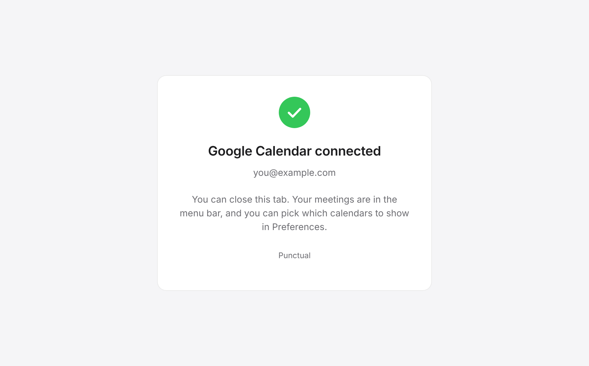

# Emails and web pages

**Punctual never sends email.** It has no email account, server, templates, or mailing list, and nothing about your calendar leaves your Mac by email. There are three places where it hands off to your own mail app, plus one web page it shows in your browser.

## Email attendees

In the [dropdown](dropdown.md#meeting-rows), expand a meeting and choose **Email attendees**. Punctual opens a new message in your default mail app (through the macOS share service) and fills in:

| Field | Content |
|---|---|
| To | Every attendee who has an email address |
| Subject | The meeting title |
| Body | Empty |

Nothing is sent until you press Send in your mail app. There are no settings for this.

## Contact

[About & Support](preferences/about.md) ▸ **Contact** opens a new message to the developer with the subject "Punctual" in your default mail app.

## Copy a report for support

[About & Support](preferences/about.md) ▸ **Copy a report for support** copies a plain-text diagnostics report to the clipboard, ready to paste into an email or a GitHub issue. It contains no meeting titles or attendees. The **Last error** line repeats the most recent error message as the app recorded it, which can name an account address or a calendar ID, so read it before you share the report:

```
Punctual 1.1.2 (42)
macOS: 15.5
Provider: Calendar.app (EventKit)
Provider health: ok
Stale data: no
Auth required: no
Calendars: 3 selected / 7 available
Visible events: 5
Last successful refresh: 2026-11-09 09:34
Last attempted refresh: 2026-11-09 09:34
Last error: none
Calendar permission: authorized
Notification permission: authorized
Google auth: n/a
Script file: not found
App source: direct
```

(Values above are an example.)

## Google sign-in confirmation page

When you connect Google Calendar (during [setup](getting-started.md) or in [Preferences ▸ Calendars](preferences/calendars.md)), Google's sign-in opens in your browser. After you approve, the browser returns to Punctual and shows this page, served from your own Mac on the loopback address (127.0.0.1), never from the network. The small page server stays up after sign-in, so a reload still shows the page, and stops when you next sign in or sign out. It follows the browser's light or dark appearance, and shows the account you connected.

<picture>
  <source media="(prefers-color-scheme: dark)" srcset="images/web/oauth-complete-dark.png">
  
</picture>

| Part | Content |
|---|---|
| Tab title | Connected — Punctual |
| Heading | Google Calendar connected |
| Account line | The Google account's address (left out if Google doesn't provide one) |
| Text | You can close this tab. Your meetings are in the menu bar, and you can pick which calendars to show in Preferences. |

If you connected from Preferences, Punctual also posts a "Google Account connected" message ([in-app messages](notifications-and-alerts.md#in-app-messages)). During first-run setup it doesn't, since this page already confirmed it.

The page's template is `OAuthCompletionPage.swift`, and its screenshot is rendered from that template.
